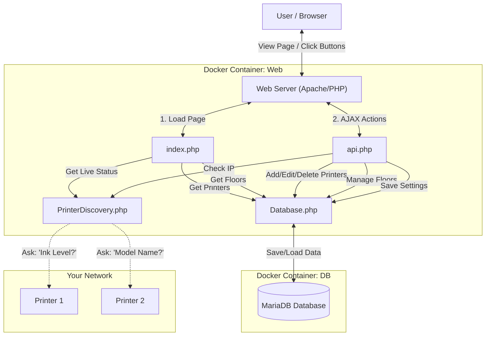

# Sprinter Architecture & How It Works

This document explains how the Sprinter application is built and how its different parts talk to each other.

## 🏗️ System Overview

Sprinter is a **web application** that monitors printers on your network. It stores printer details in a database and uses SNMP (Simple Network Management Protocol) to talk to printers and get their ink/toner levels.

### The Big Picture

## 📂 Key Files Explained

### 1. `index.php` (The Main Page)
*   **What it does:** This is the "face" of the application. It's what you see when you open the site.
*   **How it works:**
    1.  Connects to the database to get the list of saved printers, floors, and settings.
    2.  For each printer, it asks `PrinterDiscovery.php` to get live data (ink levels, online status).
    3.  It generates the HTML cards (cubes) for each printer.
    4.  It renders the floor sidebar for filtering printers by location.
    5.  It handles the "Database Loading" screen if the database isn't ready yet.

### 2. `script.js` (The Brains in the Browser)
*   **What it does:** Handles everything that happens *after* the page loads without refreshing.
*   **Key jobs:**
    *   **Modals:** Opens and closes the "Add/Edit Printer" and "Settings" popups.
    *   **Searching:** Filters the printer list instantly when you type.
    *   **Theme:** Toggles between Dark and Light mode.
    *   **Floor Filtering:** Shows/hides printers based on selected floor.
    *   **Settings:** Manages floor CRUD and display settings.
    *   **Import/Export:** Allows backup and restore of printer data as JSON.
    *   **Talking to Server:** Sends background requests (AJAX) to `api.php`.

### 3. `api.php` (The Worker)
*   **What it does:** A hidden helper that processes requests from `script.js`. It doesn't show a page; it just sends back data (JSON).
*   **Actions:**
    *   `check_ip`: Asks `PrinterDiscovery` to scan an IP and return the model name.
    *   `add_printer`: Tells `Database` to save a new printer.
    *   `update_printer`: Tells `Database` to update an existing printer.
    *   `delete_printer`: Tells `Database` to remove a printer.
    *   `get_floors`: Returns all configured floors.
    *   `add_floor`: Creates a new floor.
    *   `edit_floor`: Updates a floor name.
    *   `delete_floor`: Removes a floor.
    *   `get_settings`: Returns display settings.
    *   `save_settings`: Saves display settings.
    *   `export_printers`: Returns all printers as JSON for backup.
    *   `import_printers`: Imports printers from JSON backup.

### 4. `Database.php` (The Librarian)
*   **What it does:** Manages the connection to the MariaDB database.
*   **Key jobs:**
    *   Connects securely using a username/password.
    *   Runs SQL commands (INSERT, UPDATE, DELETE, SELECT).
    *   Protects against "SQL Injection" attacks by using safe placeholders (Prepared Statements).
    *   Manages three tables: `printers`, `floors`, and `settings`.

### 5. `PrinterDiscovery.php` (The Translator)
*   **What it does:** Speaks "SNMP" language to talk to printers.
*   **How it works:**
    *   It sends special codes (OIDs) to a printer's IP address.
    *   The printer replies with raw data (e.g., "100" for max ink, "50" for current ink).
    *   This file does the math to turn those numbers into percentages (50%).
    *   It knows the specific codes for HP, Canon, Brother, etc.

### 6. CSS Files (The Look & Feel)
*   **Modular Structure:** CSS is split into logical files in `src/css/`:
    *   `base.css` - Variables, resets, theme overrides
    *   `layout.css` - Header, main layout, sidebar, container grid
    *   `components.css` - Printer cubes, buttons, level bars, status indicators
    *   `modals.css` - Modal dialogs, forms, settings, toggle switches
    *   `responsive.css` - Media queries, mobile adjustments, animations

## 🔄 Common Workflows

### Adding a Printer
1.  **User** clicks `+` button -> `script.js` opens modal.
2.  **User** types IP and clicks "Check IP".
3.  `script.js` asks `api.php` -> `api.php` asks `PrinterDiscovery.php`.
4.  `PrinterDiscovery.php` talks to **Printer** -> returns "HP LaserJet".
5.  **User** selects a floor and clicks "Save".
6.  `script.js` sends data to `api.php` -> `api.php` saves to `Database.php` -> **MariaDB**.
7.  Page reloads to show the new printer.

### Viewing the Dashboard
1.  **Browser** requests page.
2.  `index.php` gets list from **MariaDB** (printers, floors, settings).
3.  `index.php` loops through list, getting live status from **Printers**.
4.  Page sends HTML to **Browser**.
5.  User can filter by floor using the sidebar or search.

### Managing Floors
1.  **User** clicks settings gear -> opens Settings modal.
2.  User adds/edits/deletes floors in "Manage Floors" tab.
3.  Changes are saved via `api.php` to **MariaDB**.
4.  Page reloads to update floor sidebar.
