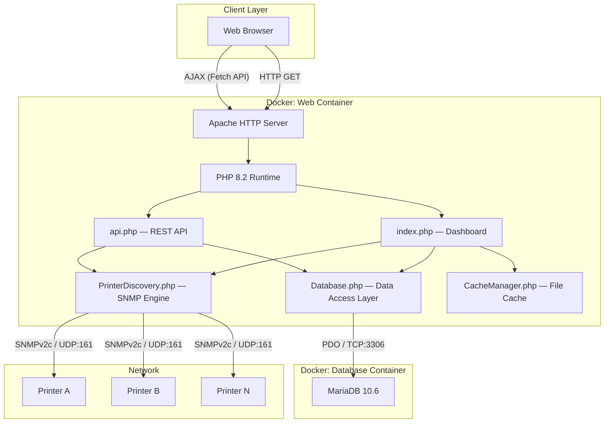
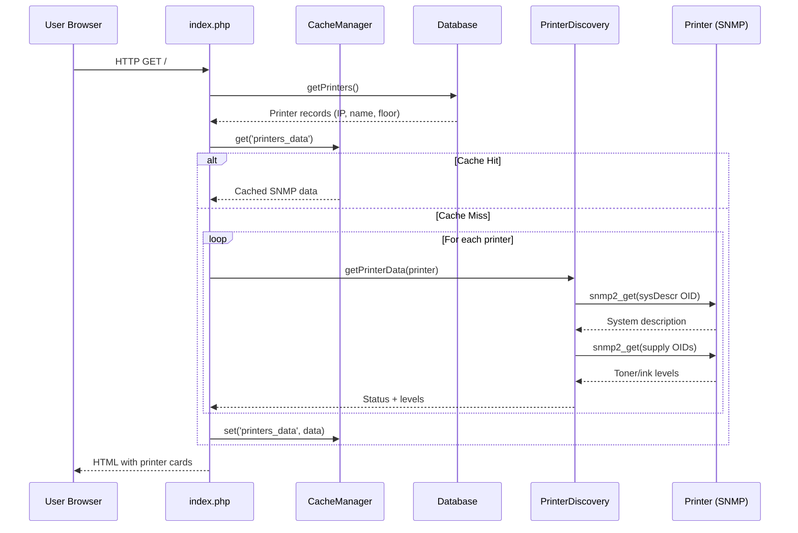
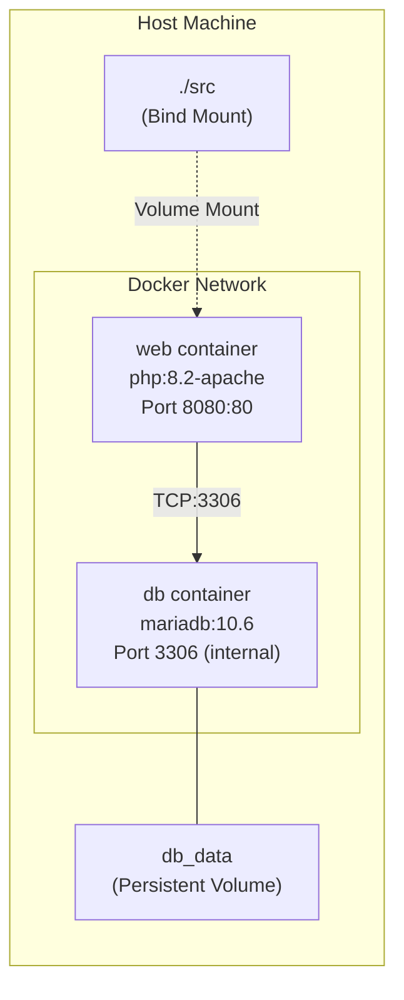
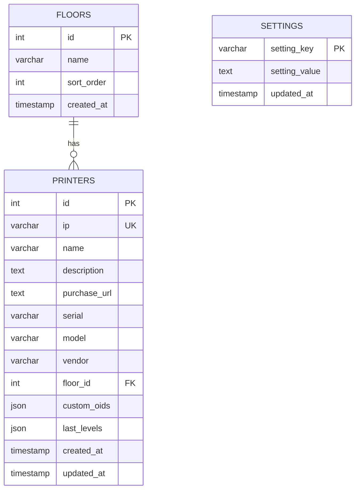

# S-Printer (Sprinter) — Technical Architecture Document

> **Purpose**: Comprehensive technical documentation for thesis writing. Covers system design, protocol theory, implementation patterns, and best practices analysis with annotated code snippets.

---

## 1. System Overview

Sprinter is a web-based printer monitoring application that queries network printers using SNMP (Simple Network Management Protocol) and displays real-time toner/ink levels on a dashboard. The application is containerized with Docker and uses a MariaDB database for persistent storage.

### 1.1 High-Level Architecture



### 1.2 Request Lifecycle



---

## 2. SNMP Protocol Foundation

### 2.1 What is SNMP

Simple Network Management Protocol (SNMP) is an Internet Standard protocol defined by the IETF for monitoring and managing network devices. It operates on the application layer over UDP port 161.

**Key concepts:**
- **Agent**: Software on the managed device (printer) that responds to queries
- **Manager**: The monitoring application (Sprinter) that sends queries
- **Community String**: Authentication credential (default: `"public"`, read-only)
- **OID**: Object Identifier — a unique address for each data point on the device

### 2.2 OID Tree Structure (RFC 3805 — Printer MIB v2)

RFC 3805, titled "Printer MIB v2," defines the standard Management Information Base for printers. The supply-related OIDs used by Sprinter are:

```
iso(1).org(3).dod(6).internet(1).mgmt(2).mib-2(1).printmib(43)
├── .5.1.1  — General Printer Info
│   ├── .16.1  — prtGeneralPrinterName
│   └── .17.1  — prtGeneralSerialNumber
├── .11.1.1 — Marker Supplies Table
│   ├── .6.1.X — prtMarkerSuppliesDescription (e.g., "Black Toner")
│   ├── .7.1.X — prtMarkerSuppliesSupplyUnit
│   ├── .8.1.X — prtMarkerSuppliesMaxCapacity
│   └── .9.1.X — prtMarkerSuppliesLevel (current level)
└── .12.1.1 — Marker Colorant Table
    └── .4.1.X — prtMarkerColorantValue (color name)
```

Where `X` is the supply index (1 = first supply, 2 = second, etc.).

### 2.3 SNMP Queries in Practice

Sprinter uses the PHP `snmp2_get()` and `snmp2_real_walk()` functions to query printers:

```php
// Single OID query — ask for one specific value
$value = snmp2_get(
    $ip,              // Printer IP address
    $this->community, // Community string ("public")
    $oid,             // OID to query
    $this->timeout,   // Microseconds to wait (500000 = 0.5s)
    $this->retries    // Retry count if timeout
);

// Walk — enumerate all entries under an OID subtree
$supplyTable = snmp2_real_walk(
    $ip,
    $this->community,
    '.1.3.6.1.2.1.43.11.1.1', // Walk entire supply table
    $this->timeout,
    $this->retries
);
```

### 2.4 Supply Level Calculation

Toner percentage is calculated from two OID values:

```php
// OID .8.1.X = maximum capacity
// OID .9.1.X = current level
$percentage = round(($current / $max) * 100, 2);
```

**Special SNMP return codes (RFC 3805 Section 2):**
| Value | Meaning |
|-------|---------|
| `-1`  | Other / unknown |
| `-2`  | Unknown status |
| `-3`  | Supply is above threshold — exact level not available |

### 2.5 Vendor-Specific OID Challenges

While RFC 3805 defines a standard, manufacturers implement OIDs differently:

| Challenge | Example | Sprinter's Solution |
|-----------|---------|-------------------|
| Supply index varies | Brother mono: index 1 = Drum, index 2 = Toner | Standard MIB walk reads description text |
| Proprietary OIDs | Brother inkjet uses `.1.3.6.1.4.1.2435.2.3.9...` | Dedicated `getBrotherInkjetLevels()` method |
| Hex-encoded responses | Pantum serial returns `Hex-STRING: 00 00 00 00` | `sanitizeSnmpValue()` converts hex to ASCII |
| Color OID ordering | Toshiba e-STUDIO409S does not follow standard order | Model-specific OID override |

---

## 3. PHP 8 Implementation & Best Practices

### 3.1 Strict Type Declarations

Every PHP file begins with `declare(strict_types=1)`, enforcing that function arguments and return values match their declared types exactly. This prevents PHP's default implicit type coercion.

```php
<?php
declare(strict_types=1);

class PrinterDiscovery {
    private string $community;  // Typed properties (PHP 7.4+)
    private int $timeout;
    private int $retries;

    public function __construct(
        string $community = 'public',
        int $timeout = 500000,
        int $retries = 2
    ) {
        $this->community = $community;
        $this->timeout = $timeout;
        $this->retries = $retries;
    }
}
```

**Best practice applied**: Typed properties (`private string $community`) ensure class fields cannot hold incorrect types, catching bugs at assignment time rather than at runtime usage.

### 3.2 SQL Injection Prevention with PDO Prepared Statements

All database queries use PDO prepared statements with named parameters:

```php
public function addPrinter(array $data): bool {
    $sql = "INSERT INTO printers
            (ip, name, description, purchase_url, serial, model, vendor, floor_id)
            VALUES (:ip, :name, :description, :purchase_url,
                    :serial, :model, :vendor, :floor_id)";

    $stmt = $this->pdo->prepare($sql);
    return $stmt->execute([
        ':ip'           => $data['ip'],
        ':name'         => $data['name'] ?? null,
        ':description'  => $data['description'] ?? null,
        ':purchase_url' => $data['purchase_url'] ?? null,
        ':serial'       => $data['serial'] ?? null,
        ':model'        => $data['model'] ?? null,
        ':vendor'       => $data['vendor'] ?? null,
        ':floor_id'     => !empty($data['floor_id'])
                           ? (int)$data['floor_id']
                           : null,
    ]);
}
```

**Key security configurations in the PDO constructor:**

```php
$options = [
    PDO::ATTR_ERRMODE            => PDO::ERRMODE_EXCEPTION,
    PDO::ATTR_DEFAULT_FETCH_MODE => PDO::FETCH_ASSOC,
    PDO::ATTR_EMULATE_PREPARES   => false,  // Use native prepared statements
];
$this->pdo = new PDO($dsn, $user, $pass, $options);
```

Setting `ATTR_EMULATE_PREPARES` to `false` forces the database driver to use native prepared statements rather than client-side emulation, providing stronger SQL injection protection.

### 3.3 Nullable Return Types and Null Coalescing

```php
// Nullable return type  —  returns array or null
public function detectPrinter(string $ip): ?array {
    if (!filter_var($ip, FILTER_VALIDATE_IP)) {
        return null;
    }
    // ...
}

// Null coalescing operator (??) for safe defaults
$printerData['info']['full_name'] =
    $dbPrinter['name']
    ?: ($dbPrinter['model'] ?: 'Unknown Printer');
```

### 3.4 Error Handling Strategy

The application uses a layered error handling approach:

```php
// Layer 1: SNMP errors suppressed with @ operator (expected failures)
$sysDescr = @snmp2_get($ip, $this->community, $oid, ...);
if ($sysDescr === false) {
    return null;  // Printer not reachable — not an error
}

// Layer 2: Database errors caught and stored
try {
    $this->pdo = new PDO($dsn, $user, $pass, $options);
} catch (\PDOException $e) {
    $this->lastError = "Connection failed: " . $e->getMessage();
    error_log($this->lastError);
}

// Layer 3: API returns structured JSON errors with 'never' return type (PHP 8.1+)
// Detailed errors logged server-side; generic messages returned to user (OWASP)
function sendError(string $message): never {
    echo json_encode(['success' => false, 'error' => $message]);
    exit;
}

function sendResponse(mixed $data = null): never {
    echo json_encode(['success' => true, 'data' => $data]);
    exit;
}
```

The `never` return type explicitly documents that these functions halt execution, aiding static analysis tools and making the control flow clear to other developers.

### 3.5 Output Escaping (XSS Prevention)

All user-controlled data rendered in HTML is escaped:

```php
<!-- Correct: htmlspecialchars prevents script injection -->
<?= htmlspecialchars($data['info']['full_name'] ?? 'N/A') ?>

<!-- For attributes with JSON data -->
onclick="openEditModal(<?= htmlspecialchars(json_encode($data['info'])) ?>)"
```

---

## 4. JavaScript Implementation & Best Practices

### 4.1 Async/Await Pattern for API Calls

All server communication uses the modern `async/await` syntax with the Fetch API:

```javascript
async function checkIp() {
    const ip = document.getElementById('printerIp').value;
    const statusSpan = document.getElementById('ipStatus');

    try {
        const response = await fetch('api.php?action=check_ip', {
            method: 'POST',
            headers: { 'Content-Type': 'application/json' },
            body: JSON.stringify({ ip: ip })
        });
        const result = await response.json();

        if (result.success) {
            statusSpan.textContent = 'Printer found! ' + result.data.full_name;
            statusSpan.className = 'status-text success';
        } else {
            statusSpan.textContent = result.error || 'Not found';
            statusSpan.className = 'status-text error';
        }
    } catch (e) {
        statusSpan.textContent = 'Network error';
        statusSpan.className = 'status-text error';
    }
}
```

### 4.2 Parallel Initialization with Promise.all

On page load, independent API calls run concurrently:

```javascript
document.addEventListener('DOMContentLoaded', async function () {
    const [settingsRes, floorsRes] = await Promise.all([
        fetch('api.php?action=get_settings'),
        fetch('api.php?action=get_floors')
    ]);
    // Both requests complete before proceeding
    window.appSettings = (await settingsRes.json()).data;
    window.appFloors = (await floorsRes.json()).data;
});
```

### 4.3 Event Delegation for Dynamic Elements

Floor management uses event delegation — a single listener on the parent handles all child button clicks:

```javascript
floorList.addEventListener('click', async function (e) {
    const btn = e.target.closest('button');     // Find clicked button
    if (!btn) return;

    const li = btn.closest('.floor-list-item'); // Find parent list item
    const floorId = li.dataset.floorId;         // Read data-* attribute

    if (btn.classList.contains('save-floor-btn')) {
        // Handle save
    } else if (btn.classList.contains('delete-floor-btn')) {
        // Handle delete
    }
});
```

**Advantage over individual listeners**: Works automatically for dynamically-added floor items without re-binding events.

### 4.4 DOM Manipulation with classList

CSS class manipulation uses the modern `classList` API instead of string concatenation:

```javascript
// Toggle visibility with CSS classes + animations
cube.classList.remove('hidden-by-filter');
cube.classList.add('visible-by-filter');
cube.style.animationDelay = `${delay * 0.05}s`;  // Stagger effect
```

### 4.5 localStorage for State Persistence

User preferences persist across sessions without server roundtrips:

```javascript
// Theme preference
const currentTheme = localStorage.getItem('theme') || 'dark';
if (currentTheme === 'light') {
    document.documentElement.classList.add('light-theme');
}

// Floor selection
const savedFloor = localStorage.getItem('activeFloor') || 'all';
setActiveFloor(savedFloor);
```

---

## 5. Docker Containerization

### 5.1 Container Architecture



### 5.2 Dockerfile Analysis

```dockerfile
FROM php:8.2-apache

# Single RUN command reduces image layers
# --no-install-recommends minimizes package footprint
RUN apt-get update && \
    apt-get install -y --no-install-recommends \
    libsnmp-dev snmp && \
    docker-php-ext-install snmp pdo_mysql && \
    a2enmod rewrite headers && \
    apt-get clean && \
    rm -rf /var/lib/apt/lists/*

# Security: disable directory listing
# apache-vhost.conf sets Options -Indexes
COPY apache-vhost.conf /etc/apache2/sites-available/000-default.conf

# Container health monitoring
HEALTHCHECK --interval=30s --timeout=3s \
    CMD curl -f http://localhost/ || exit 1
```

**Best practices applied:**
| Practice | Implementation |
|----------|---------------|
| Single RUN layer | All `apt-get` and extensions in one `RUN` |
| Cache cleanup | `apt-get clean && rm -rf /var/lib/apt/lists/*` |
| Health check | `HEALTHCHECK` instruction for container orchestration |
| Pinned base image | `php:8.2-apache` (not `latest`) |
| Minimal packages | `--no-install-recommends` flag |
| `.dockerignore` | Excludes `.git`, `*.md`, IDE files, OS files from build context |

### 5.3 Docker Compose — Service Orchestration

```yaml
services:
  web:
    build: .
    ports:
      - "8080:80"
    volumes:
      - ./src:/var/www/html     # Bind mount for development
    environment:
      - DB_HOST=db              # Service name as hostname
      - SNMP_COMMUNITY=public
    depends_on:
      - db                      # Start database first

  db:
    image: mariadb:10.6
    volumes:
      - db_data:/var/lib/mysql  # Named volume for persistence
    restart: unless-stopped

volumes:
  db_data:                      # Survives container recreation
```

**Key design decisions:**
- `depends_on` ensures the database container starts before the web container (though the app handles connection failures gracefully with auto-retry)
- Bind mount (`./src:/var/www/html`) enables live code editing during development
- Named volume (`db_data`) ensures database data survives `docker-compose down`

---

## 6. Security Implementation

### 6.1 HTTP Security Headers

Applied at both Apache and PHP levels for defense in depth:

```
X-Content-Type-Options: nosniff      — Prevents MIME type sniffing
X-Frame-Options: DENY                — Blocks iframe embedding (clickjacking)
X-XSS-Protection: 1; mode=block     — Legacy XSS filter
Referrer-Policy: same-origin         — Limits referrer leakage
Content-Security-Policy:             — Controls resource loading:
  default-src 'self';                  Only same-origin resources
  script-src 'self' 'unsafe-inline';   Scripts from same origin
  style-src 'self' 'unsafe-inline';    Styles from same origin
  img-src 'self' data:;               Images + data URIs
  connect-src 'self'                   AJAX to same origin only
```

### 6.2 Input Validation

```php
// IP address validation before SNMP queries
if (!filter_var($ip, FILTER_VALIDATE_IP)) {
    return null;
}

// API parameter validation
if (empty($input['ip'])) {
    sendError('IP address is required');
}

// Settings whitelist — only approved keys can be saved
if (in_array($key, ['hide_ip', 'show_serial'])) {
    $db->setSetting($key, (string)$value);
}
```

### 6.3 CSRF Prevention via Content-Type Enforcement

The API uses a lightweight CSRF prevention strategy recommended by OWASP for JSON APIs. Since all API calls use `Content-Type: application/json`, which triggers a CORS preflight for cross-origin requests, a full CSRF token system is unnecessary. Instead, strict Content-Type validation on the server prevents attackers from bypassing preflight with `text/plain` form submissions:

```php
// Strict Content-Type validation for POST requests (OWASP CSRF prevention)
if ($_SERVER['REQUEST_METHOD'] === 'POST') {
    $contentType = $_SERVER['CONTENT_TYPE'] ?? '';
    if (stripos($contentType, 'application/json') === false) {
        http_response_code(415); // Unsupported Media Type (RFC 7231)
        sendError('Content-Type must be application/json');
    }
}
```

### 6.4 HTTP Method Enforcement

All write actions enforce POST-only access, returning HTTP 405 Method Not Allowed for other methods:

```php
case 'add_printer':
case 'edit_printer':
case 'delete_printer':
    if ($_SERVER['REQUEST_METHOD'] !== 'POST') {
        http_response_code(405);
        sendError('Method not allowed');
    }
    // ... handle action
```

### 6.5 Error Message Sanitization

Detailed database errors are logged server-side via `error_log()`, while users receive generic messages. This prevents information disclosure per OWASP guidelines:

```php
// Detailed error logged for administrators
error_log('Add printer failed: ' . $db->getLastError());
// Generic message returned to client
sendError('Failed to add printer. The IP may already exist.');
```

### 6.6 Client-Side XSS Prevention

```javascript
// Safe HTML escaping for dynamic content
function escapeHtml(text) {
    const div = document.createElement('div');
    div.textContent = text;   // textContent never parses HTML
    return div.innerHTML;
}
```

---

## 7. Design Patterns

### 7.1 Strategy Pattern — Vendor-Specific SNMP Handling

The `getDirectSupplyLevels()` method uses a strategy-like approach where the OID mapping changes based on the detected vendor:

```php
$oidMappings = [
    'HP'      => ['max_black' => '...8.1.1', 'black' => '...9.1.1', ...],
    'TOSHIBA' => ['max_black' => '...8.1.2', 'black' => '...9.1.2', ...],
    'BROTHER' => ['max_black' => '...8.1.1', 'black' => '...9.1.1', ...],
    // ...
];

$oids = $oidMappings[$vendorName] ?? $oidMappings['GENERIC'];
```

### 7.2 Template Method — Two-Phase Supply Detection

Supply level retrieval follows a template method pattern with two phases:

```
1. Try vendor-specific direct OIDs  (fast, may fail)
2. Fall back to standard MIB walk   (universal, slower)
```

```php
private function getSupplyLevels(string $ip): array {
    // Phase 1: Direct vendor OIDs
    $directLevels = $this->getDirectSupplyLevels($ip);
    if (!empty($directLevels)) {
        return $directLevels;
    }

    // Phase 2: Standard MIB walk fallback
    $supplyTable = snmp2_real_walk($ip, ..., '.1.3.6.1.2.1.43.11.1.1', ...);
    // Parse descriptions, calculate percentages...
}
```

### 7.3 Caching Strategy — Cache-Aside Pattern with Write Invalidation

```php
// Read path: check cache first (index.php)
$cachedData = $cacheManager->get($cacheKey);
if (!empty($cachedData)) {
    $printers = $cachedData;  // Use cached SNMP data
}

// Only query printers if cache missed
if (empty($printers)) {
    foreach ($dbPrinters as $dbPrinter) {
        $data = $discovery->getPrinterData($dbPrinter);
        $printers[$dbPrinter['ip']] = $data;
    }
    $cacheManager->set($cacheKey, $printers);  // Store for 5 minutes
}

// Write path: invalidate cache after mutations (api.php)
// Ensures dashboard shows changes immediately
if ($db->addPrinter($input)) {
    (new CacheManager('cache'))->delete('printers_data');
    sendResponse();
}
```

---

## 8. Database Schema



**Schema migration pattern** — The application handles upgrades gracefully:

```php
// Check if column exists before adding
$check = $this->pdo->query("SHOW COLUMNS FROM printers LIKE 'last_levels'");
if ($check->rowCount() === 0) {
    $this->pdo->exec("ALTER TABLE printers ADD COLUMN last_levels JSON ...");
}
```

---

## 9. CSS Architecture

The stylesheet is modularized into five files following separation of concerns:

| File | Responsibility | Key Features |
|------|---------------|--------------|
| `base.css` | Design tokens, theme variables, resets | CSS custom properties for dark/light themes |
| `layout.css` | Page structure, grid, sidebar | CSS Grid for printer card layout |
| `components.css` | Printer cards, buttons, level bars | Animated toner bars, status indicators |
| `modals.css` | Dialog windows, forms, settings | Overlay with backdrop blur |
| `responsive.css` | Media queries, mobile adjustments | Breakpoints for tablet/mobile |

**Theme system using CSS Custom Properties:**

```css
:root {
    /* Everforest Dark Theme */
    --bg: #2d353b;
    --fg: #d3c6aa;
    --primary: #7fbbb3;
    --cube-bg: #475258;
    --cyan: #7fbbb3;
    --magenta: #d699b6;
    --yellow: #dbbc7f;
}

.light-theme {
    --bg: #f8f0dc;
    --fg: #5c6a72;
    --primary: #8da101;
    --cube-bg: #e9e5cf;
}
```

---

## 10. Naming Conventions

The codebase follows these conventions consistently:

| Context | Convention | Examples |
|---------|-----------|----------|
| PHP classes | PascalCase | `PrinterDiscovery`, `CacheManager` |
| PHP methods | camelCase | `getPrinterData()`, `detectVendor()` |
| PHP variables | camelCase | `dbPrinter`, `sysDescr`, `vendorName` |
| JS functions | camelCase | `setupSearch()`, `checkIp()`, `deletePrinter()` |
| JS DOM IDs | camelCase | `printerSearch`, `settingsBtn`, `floorList` |
| CSS classes | kebab-case | `level-fill`, `cube-footer`, `settings-nav-item` |
| DB columns | snake_case | `floor_id`, `purchase_url`, `last_levels` |
| API actions | snake_case | `check_ip`, `add_printer`, `export_printers` |

No Hungarian notation is used anywhere in the codebase.

---

## 11. Resolved Bugs & Root Cause Analysis

### Bug 1: Brother Mono Laser Shows "Cyan" Instead of "Black" ✅

**Affected models**: DCP-L, HL-L, MFC-L series (monochrome lasers)

**Root cause**: The hardcoded BROTHER OID mapping assumes index 1 = Black, index 2 = Cyan. On mono laser printers, index 1 = Drum Unit (returns `-3`), index 2 = Black Toner. The code maps index 2 to "cyan" by name.

**Fix applied**: Brother mono lasers now skip direct OIDs; the standard MIB walk reads supply descriptions to correctly identify toner vs drum.

### Bug 2: Pantum Printers Not Recognized ✅

**Root cause**: `detectVendor()` had no `'PANTUM'` entry. Fell to `GENERIC`.

**Fix applied**: Added `'PANTUM' => ['pantum']` to vendor detection and mono-only OID mapping.

### Bug 3: Serial Shows "Hex-STRING: 00 00 00 00" ✅

**Root cause**: `sanitizeSnmpValue()` stripped `STRING:`, `INTEGER:`, `Counter32:`, `Gauge32:`, `Timeticks:` prefixes but not `Hex-STRING:`.

**Fix applied**: `Hex-STRING:` values are now decoded from hex bytes to ASCII. All-null values return `N/A`.
