# S-Printer (Sprinter). Techninės architektūros dokumentas

> **Paskirtis**: išsami techninė dokumentacija, skirta baigiamojo darbo rašymui. Apima sistemos projektavimą, protokolų teoriją, realizacijos šablonus ir geriausių praktikų analizę su kodo pavyzdžiais.

---

## 1. Sistemos apžvalga

Sprinter yra žiniatinklio pagrindu veikianti spausdintuvų stebėjimo programa, kuri apklausia tinklo spausdintuvus naudodama SNMP (Simple Network Management Protocol) protokolą ir realiu laiku rodo dažų bei rašalo lygius autentifikuotame informaciniame skydelyje (angl. dashboard). Programa yra konteinerizuota naudojant Docker technologiją ir duomenų saugojimui naudoja MariaDB duomenų bazę, kurioje saugomi spausdintuvai, aukštai, nustatymai ir vietiniai vartotojai.

### 1.1 Aukšto lygio architektūra

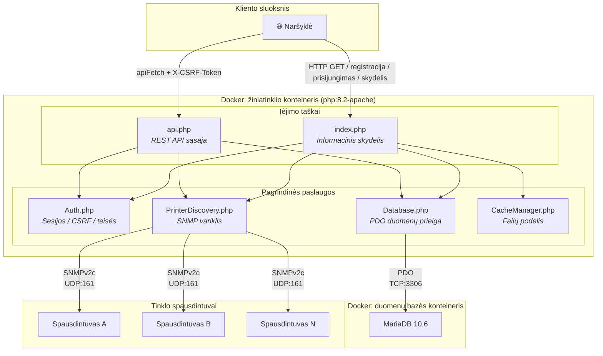

### 1.2 Užklausos gyvavimo ciklas

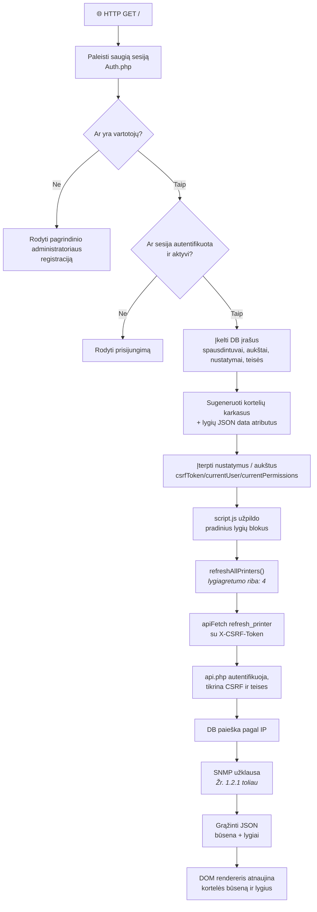

#### 1.2.1 SNMP užklausos detalės (kiekvienam spausdintuvui)

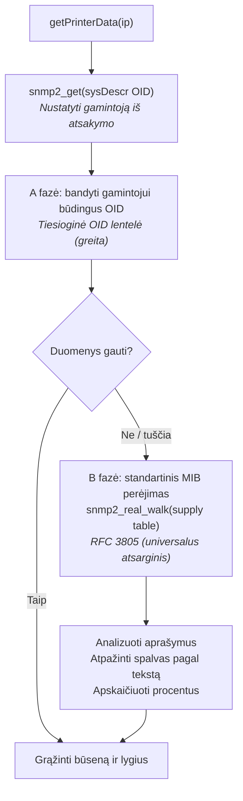

---

## 2. SNMP protokolo pagrindai

### 2.1 Kas yra SNMP

SNMP (Simple Network Management Protocol) yra IETF organizacijos apibrėžtas interneto standartų protokolas, skirtas tinklo įrenginių stebėjimui ir valdymui. Jis veikia taikomajame (angl. application) sluoksnyje ir naudoja UDP 161 prievadą.

Pagrindinės sąvokos:

| Sąvoka | Aprašymas |
|--------|-----------|
| Agentas (Agent) | Programinė įranga valdomame įrenginyje (spausdintuve), kuri atsako į užklausas |
| Valdytojas (Manager) | Stebėjimo programa (Sprinter), kuri siunčia užklausas |
| Bendruomenės eilutė (Community String) | Autentifikacijos kredencialas (numatytasis: `"public"`, tik skaitymui) |
| OID (Object Identifier) | Unikalus adresas kiekvienam duomenų taškui įrenginyje |

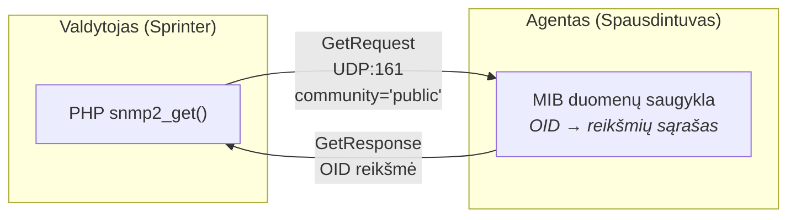

### 2.2 OID medžio struktūra (RFC 3805: Printer MIB v2)

RFC 3805 standartas, pavadintas „Printer MIB v2", apibrėžia standartinę valdymo informacijos bazę (MIB) spausdintuvams. Sprinter naudoja šiuos su eksploatacinėmis medžiagomis susijusius OID:

```
iso(1).org(3).dod(6).internet(1).mgmt(2).mib-2(1).printmib(43)
├── .5.1.1  — Bendra spausdintuvo informacija
│   ├── .16.1  — prtGeneralPrinterName
│   └── .17.1  — prtGeneralSerialNumber
├── .11.1.1 — Eksploatacinių medžiagų lentelė
│   ├── .6.1.X — prtMarkerSuppliesDescription (pvz., „Black Toner")
│   ├── .7.1.X — prtMarkerSuppliesSupplyUnit
│   ├── .8.1.X — prtMarkerSuppliesMaxCapacity
│   └── .9.1.X — prtMarkerSuppliesLevel (esamas lygis)
└── .12.1.1 — Dažiklių lentelė
    └── .4.1.X — prtMarkerColorantValue (spalvos pavadinimas)
```

Čia `X` reiškia medžiagos indeksą (1 = pirmoji medžiaga, 2 = antroji ir t. t.).

### 2.3 SNMP užklausos praktikoje

Sprinter naudoja PHP funkcijas `snmp2_get()` ir `snmp2_real_walk()` spausdintuvų apklausai:

```php
// Vieno OID užklausa: prašoma vienos konkrečios reikšmės
$value = snmp2_get(
    $ip,              // Spausdintuvo IP adresas
    $this->community, // Bendruomenės eilutė ("public")
    $oid,             // Užklausiamas OID
    $this->timeout,   // Laukimo laikas mikrosekundėmis (500000 = 0,5 s)
    $this->retries    // Pakartojimų skaičius, jei baigėsi laukimo laikas
);

// Perėjimas (walk): peržiūrimi visi įrašai nurodytame OID pomedyje
$supplyTable = snmp2_real_walk(
    $ip,
    $this->community,
    '.1.3.6.1.2.1.43.11.1.1', // Visa eksploatacinių medžiagų lentelė
    $this->timeout,
    $this->retries
);
```

### 2.4 Medžiagų lygio apskaičiavimas

Dažų procentinė dalis apskaičiuojama iš dviejų OID reikšmių:

```php
// OID .8.1.X = maksimali talpa
// OID .9.1.X = esamas lygis
$percentage = round(($current / $max) * 100, 2);
```

Specialūs SNMP grąžinimo kodai (RFC 3805, 2 skyrius):

| Reikšmė | Prasmė |
|---------|--------|
| `-1`    | Kita / nežinoma |
| `-2`    | Nežinoma būsena |
| `-3`    | Medžiagos kiekis viršija slenkstį, tikslus lygis neprieinamas |

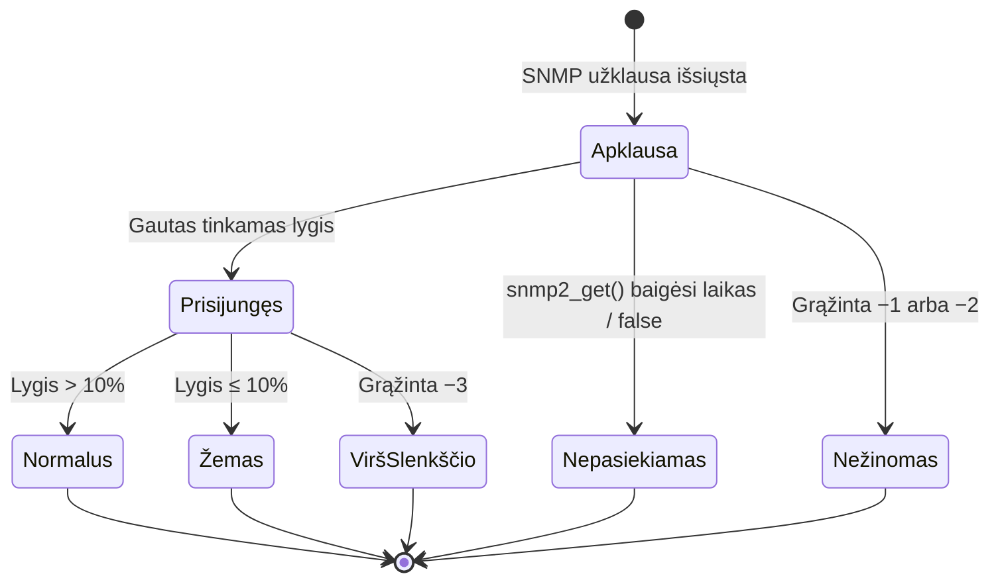

### 2.5 Gamintojams būdingi OID iššūkiai

Nors RFC 3805 apibrėžia standartą, gamintojai OID realizuoja skirtingai:

| Iššūkis | Pavyzdys | Sprinter sprendimas |
|---------|----------|---------------------|
| Medžiagų indeksai skiriasi | Brother mono: indeksas 1 = būgnas, indeksas 2 = dažai | Standartinis MIB perėjimas nuskaito aprašymo tekstą |
| Nuosavybiniai OID | Brother rašalinis naudoja `.1.3.6.1.4.1.2435.2.3.9...` | Specialus `getBrotherInkjetLevels()` metodas |
| Šešioliktainiu koduoti atsakymai | Pantum serijinis numeris grąžina `Hex-STRING: 00 00 00 00` | `sanitizeSnmpValue()` konvertuoja iš šešioliktainio į ASCII |
| Spalvų OID tvarka neatitinka standarto | Toshiba e-STUDIO409S nesilaiko standartinės tvarkos | Modeliui pritaikytas OID perrašymas |

---

## 3. PHP 8 realizacija ir geriausios praktikos

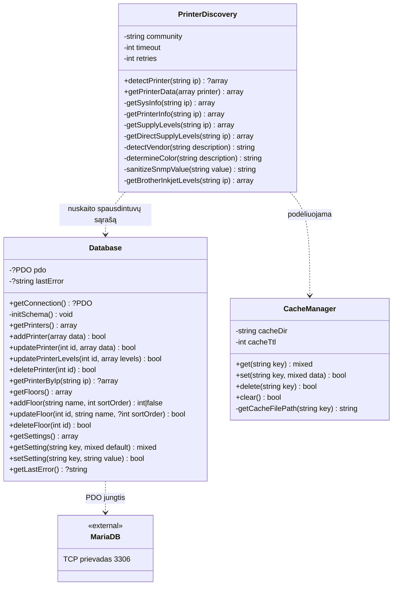

### 3.1 Griežtas tipų deklaravimas

Kiekvienas PHP failas prasideda deklaracija `declare(strict_types=1)`, kuri užtikrina, kad funkcijų argumentai ir grąžinamos reikšmės tiksliai atitiktų deklaruotus tipus. Tai neleidžia PHP atlikti numatytojo netiesioginio tipų konvertavimo.

```php
<?php
declare(strict_types=1);

class PrinterDiscovery {
    private string $community;  // Tipizuotos savybės (PHP 7.4+)
    private int $timeout;
    private int $retries;

    public function __construct(
        string $community = 'public',
        int $timeout = 500000,
        int $retries = 2
    ) {
        $this->community = $community;
        $this->timeout = $timeout;
        $this->retries = $retries;
    }
}
```

Taikoma geroji praktika: tipizuotos savybės (pvz., `private string $community`) užtikrina, kad klasės laukai negalėtų saugoti netinkamo tipo reikšmių. Klaidos aptinkamos priskyrimo metu, o ne vykdymo metu.

### 3.2 SQL injekcijų prevencija naudojant PDO paruoštas užklausas

Visos duomenų bazės užklausos naudoja PDO paruoštas užklausas (angl. prepared statements) su vardiniais parametrais:

```php
public function addPrinter(array $data): bool {
    $sql = "INSERT INTO printers
            (ip, name, description, purchase_url, serial, model, vendor, floor_id)
            VALUES (:ip, :name, :description, :purchase_url,
                    :serial, :model, :vendor, :floor_id)";

    $stmt = $this->pdo->prepare($sql);
    return $stmt->execute([
        ':ip'           => $data['ip'],
        ':name'         => $data['name'] ?? null,
        ':description'  => $data['description'] ?? null,
        ':purchase_url' => $data['purchase_url'] ?? null,
        ':serial'       => $data['serial'] ?? null,
        ':model'        => $data['model'] ?? null,
        ':vendor'       => $data['vendor'] ?? null,
        ':floor_id'     => !empty($data['floor_id'])
                           ? (int)$data['floor_id']
                           : null,
    ]);
}
```

Pagrindinės saugumo konfigūracijos PDO konstruktoriuje:

```php
$options = [
    PDO::ATTR_ERRMODE            => PDO::ERRMODE_EXCEPTION,
    PDO::ATTR_DEFAULT_FETCH_MODE => PDO::FETCH_ASSOC,
    PDO::ATTR_EMULATE_PREPARES   => false,  // Naudoti natyvias paruoštas užklausas
];
$this->pdo = new PDO($dsn, $user, $pass, $options);
```

Nustatant `ATTR_EMULATE_PREPARES` į `false`, duomenų bazės tvarkyklė priverčiama naudoti natyvias paruoštas užklausas, o ne kliento pusės emuliaciją. Tai suteikia stipresnę apsaugą nuo SQL injekcijų.

### 3.3 Nullable grąžinimo tipai ir null sujungimo operatorius

```php
// Nullable grąžinimo tipas: grąžina masyvą arba null
public function detectPrinter(string $ip): ?array {
    if (!filter_var($ip, FILTER_VALIDATE_IP)) {
        return null;
    }
    // ...
}

// Null sujungimo operatorius (??) saugioms numatytosioms reikšmėms
$printerData['info']['full_name'] =
    $dbPrinter['name']
    ?: ($dbPrinter['model'] ?: 'Unknown Printer');
```

### 3.4 Klaidų apdorojimo strategija

Programa naudoja sluoksniuotą klaidų apdorojimo principą:

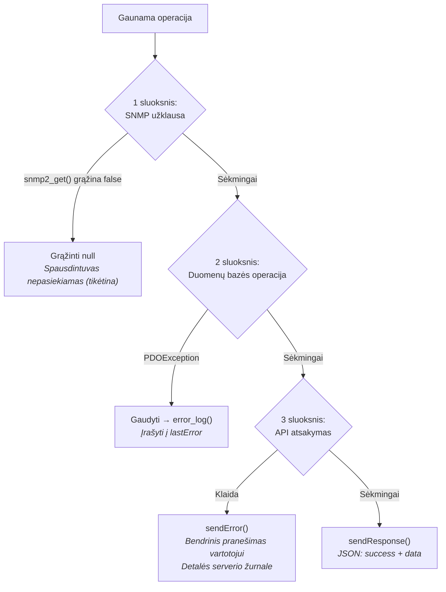

```php
// 1 sluoksnis: SNMP klaidos slopinamos @ operatoriumi (tikėtinos klaidos)
$sysDescr = @snmp2_get($ip, $this->community, $oid, ...);
if ($sysDescr === false) {
    return null;  // Spausdintuvas nepasiekiamas, tai nėra klaida
}

// 2 sluoksnis: duomenų bazės klaidos gaudamos ir saugomos
try {
    $this->pdo = new PDO($dsn, $user, $pass, $options);
} catch (\PDOException $e) {
    $this->lastError = "Connection failed: " . $e->getMessage();
    error_log($this->lastError);
}

// 3 sluoksnis: API grąžina struktūrizuotas JSON klaidas su „never" grąžinimo tipu (PHP 8.1+)
// Detalios klaidos registruojamos serverio pusėje; vartotojui rodomi bendriniai pranešimai (OWASP)
function sendError(string $message): never {
    echo json_encode(['success' => false, 'error' => $message]);
    exit;
}

function sendResponse(mixed $data = null): never {
    echo json_encode(['success' => true, 'data' => $data]);
    exit;
}
```

Grąžinimo tipas `never` aiškiai dokumentuoja, kad šios funkcijos nutraukia programos vykdymą. Tai padeda statinės analizės įrankiams ir kitiems programuotojams suprasti valdymo srautą.

### 3.5 Išvesties ekranavimas (XSS prevencija)

Visi vartotojo kontroliuojami duomenys, atvaizduojami HTML kode, yra ekranuojami:

```php
<!-- Teisingai: htmlspecialchars apsaugo nuo scenarijų injekcijos -->
<?= htmlspecialchars($data['info']['full_name'] ?? 'N/A') ?>

<!-- Atributams su JSON duomenimis -->
data-printer-info="<?= jsonForHtmlAttribute($data['info']) ?>"
```

---

## 4. JavaScript realizacija ir geriausios praktikos

### 4.1 Async/Await šablonas API kreipiniams

Visas bendravimas su serveriu naudoja modernią `async/await` sintaksę kartu su Fetch API:

```javascript
async function checkIp() {
    const ip = document.getElementById('printerIp').value;
    const statusSpan = document.getElementById('ipStatus');

    try {
        const response = await fetch('api.php?action=check_ip', {
            method: 'POST',
            headers: { 'Content-Type': 'application/json' },
            body: JSON.stringify({ ip: ip })
        });
        const result = await response.json();

        if (result.success) {
            statusSpan.textContent = 'Printer found! ' + result.data.full_name;
            statusSpan.className = 'status-text success';
        } else {
            statusSpan.textContent = result.error || 'Not found';
            statusSpan.className = 'status-text error';
        }
    } catch (e) {
        statusSpan.textContent = 'Network error';
        statusSpan.className = 'status-text error';
    }
}
```

### 4.2 Lygiagretus inicijavimas su Promise.all

Puslapio įkrovimo metu nepriklausomi API kreipiniai vykdomi lygiagrečiai:

```javascript
document.addEventListener('DOMContentLoaded', async function () {
    const [settingsRes, floorsRes] = await Promise.all([
        fetch('api.php?action=get_settings'),
        fetch('api.php?action=get_floors')
    ]);
    // Abu kreipiniai baigiami prieš tęsiant
    window.appSettings = (await settingsRes.json()).data;
    window.appFloors = (await floorsRes.json()).data;
});
```

### 4.3 Įvykių delegavimas dinaminiams elementams

Aukštų valdymas naudoja įvykių delegavimą: vienas klausytojas tėviniame elemente apdoroja visų vaikinių mygtukų paspaudimus:

```javascript
floorList.addEventListener('click', async function (e) {
    const btn = e.target.closest('button');     // Rasti paspaustą mygtuką
    if (!btn) return;

    const li = btn.closest('.floor-list-item'); // Rasti tėvinį sąrašo elementą
    const floorId = li.dataset.floorId;         // Nuskaityti data-* atributą

    if (btn.classList.contains('save-floor-btn')) {
        // Apdoroti išsaugojimą
    } else if (btn.classList.contains('delete-floor-btn')) {
        // Apdoroti ištrynimą
    }
});
```

Šio metodo privalumas lyginant su individualiais klausytojais: jis automatiškai veikia dinamiškai pridėtiems aukštų elementams, nereikalaujant iš naujo priskirti įvykių.

### 4.4 DOM manipuliavimas su classList

CSS klasių manipuliavimas naudoja modernią `classList` sąsają vietoj eilučių sujungimo:

```javascript
// Matomumo perjungimas naudojant CSS klases ir animacijas
cube.classList.remove('hidden-by-filter');
cube.classList.add('visible-by-filter');
cube.style.animationDelay = `${delay * 0.05}s`;  // Pakopinis efektas
```

### 4.5 localStorage būsenos išsaugojimui

Vartotojo nuostatos išsaugomos tarp sesijų be papildomų kreipinių į serverį:

```javascript
// Temos nuostata
const currentTheme = localStorage.getItem('theme') || 'dark';
if (currentTheme === 'light') {
    document.documentElement.classList.add('light-theme');
}

// Aukšto pasirinkimas
const savedFloor = localStorage.getItem('activeFloor') || 'all';
setActiveFloor(savedFloor);
```

---

## 5. Docker konteinerizacija

### 5.1 Konteinerių architektūra

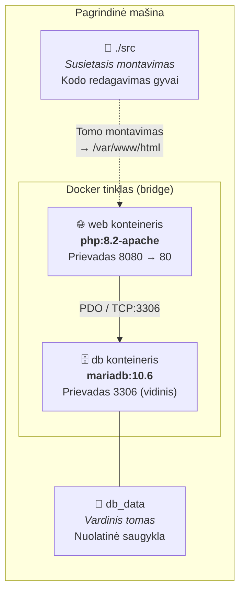

### 5.2 Dockerfile analizė

```dockerfile
FROM php:8.2-apache

# Viena RUN komanda sumažina atvaizdžio sluoksnių skaičių
# --no-install-recommends minimizuoja paketų apimtį
RUN apt-get update && \
    apt-get install -y --no-install-recommends \
    libsnmp-dev snmp && \
    docker-php-ext-install snmp pdo_mysql && \
    a2enmod rewrite headers && \
    apt-get clean && \
    rm -rf /var/lib/apt/lists/*

# Saugumas: išjungtas katalogų sąrašo rodymas
# apache-vhost.conf nustato Options -Indexes
COPY apache-vhost.conf /etc/apache2/sites-available/000-default.conf

# Konteinerio sveikatos stebėjimas
HEALTHCHECK --interval=30s --timeout=3s \
    CMD curl -f http://localhost/ || exit 1
```

Taikomos geriausios praktikos:

| Praktika | Realizacija |
|----------|-------------|
| Vienas RUN sluoksnis | Visi `apt-get` ir plėtiniai vienoje `RUN` komandoje |
| Podėlio valymas | `apt-get clean && rm -rf /var/lib/apt/lists/*` |
| Sveikatos patikra | `HEALTHCHECK` instrukcija konteinerių orkestravimui |
| Fiksuotas bazinis atvaizdis | `php:8.2-apache` (ne `latest`) |
| Minimalūs paketai | `--no-install-recommends` vėliava |
| `.dockerignore` | Išskiria `.git`, `*.md`, IDE ir OS failus iš kūrimo konteksto |

### 5.3 Docker Compose: paslaugų orkestravimas

```yaml
services:
  web:
    build: .
    ports:
      - "8080:80"
    volumes:
      - ./src:/var/www/html     # Susietasis montavimas kūrimui
    environment:
      - DB_HOST=db              # Paslaugos pavadinimas kaip kompiuterio vardas
      - SNMP_COMMUNITY=public
    depends_on:
      - db                      # Pirmiausia paleisti duomenų bazę

  db:
    image: mariadb:10.6
    volumes:
      - db_data:/var/lib/mysql  # Vardinis tomas duomenų išsaugojimui
    restart: unless-stopped

volumes:
  db_data:                      # Išlieka po konteinerio perkūrimo
```

Pagrindiniai projektavimo sprendimai:

| Sprendimas | Pagrindimas |
|------------|-------------|
| `depends_on` | Užtikrina, kad duomenų bazės konteineris būtų paleistas prieš žiniatinklio konteinerį (nors programa tvarkingai apdoroja ryšio klaidas su automatiniu pakartotiniu bandymu) |
| Susietasis montavimas (`./src:/var/www/html`) | Leidžia redaguoti kodą gyvai kūrimo metu |
| Vardinis tomas (`db_data`) | Užtikrina, kad duomenų bazės duomenys išliktų po `docker-compose down` komandos |

---

## 6. Saugumo realizacija

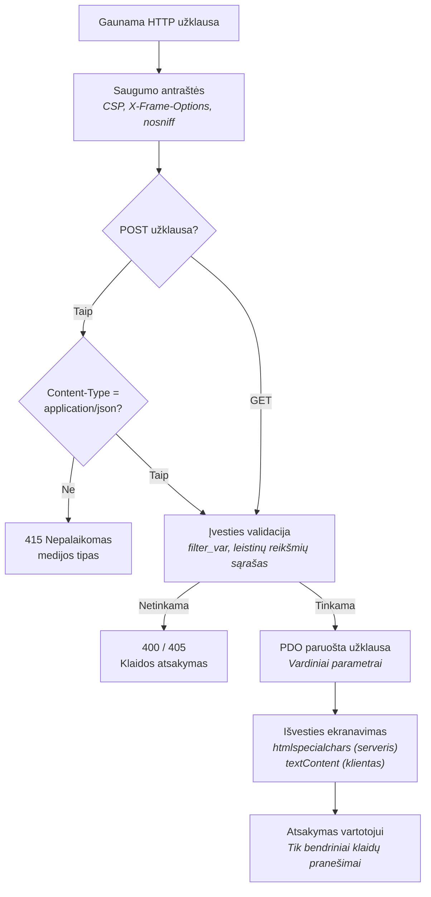

### 6.1 HTTP saugumo antraštės

Taikomos tiek Apache, tiek PHP lygmenyse pagal gynybos gilumine (angl. defense in depth) principą:

```
X-Content-Type-Options: nosniff      — Apsaugo nuo MIME tipo nuspėjimo
X-Frame-Options: DENY                — Blokuoja įterpimą per iframe (clickjacking apsauga)
X-XSS-Protection: 1; mode=block     — Senasis XSS filtras
Referrer-Policy: same-origin         — Riboja nukreipimo informacijos nutekėjimą
Content-Security-Policy:             — Valdo resursų įkrovimą:
  default-src 'self';                  Tik tos pačios kilmės resursai
  script-src 'self';                   Scenarijai tik iš tos pačios kilmės; be inline scenarijų
  style-src 'self' 'unsafe-inline';    Stiliai iš tos pačios kilmės
  img-src 'self' data:;               Paveikslėliai ir data: URI
  connect-src 'self'                   AJAX tik į tą pačią kilmę
```

### 6.2 Įvesties validacija

```php
// IP adreso validacija prieš SNMP užklausas
if (!filter_var($ip, FILTER_VALIDATE_IP)) {
    return null;
}

// API parametrų validacija
if (empty($input['ip'])) {
    sendError('IP address is required');
}

// Nustatymų leistinų reikšmių sąrašas: tik patvirtinti raktai gali būti išsaugoti
if (in_array($key, ['hide_ip', 'show_serial'])) {
    $db->setSetting($key, (string)$value);
}
```

### 6.3 Autentifikavimas, autorizavimas ir CSRF žetonai

Programa dabar naudoja vietinio pirmojo administratoriaus modelį. Pirmo paleidimo metu `index.php` rodo registracijos formą tik tada, kai `users` lentelė tuščia. Kai pagrindinė paskyra jau egzistuoja, neautentifikuotos užklausos rodo prisijungimą; Docker perkrovimai palieka vartotojų lentelę MariaDB duomenų bazėje, todėl registracija nebekartojama.

`Auth.php` centralizuoja sesijų ir slaptažodžių apdorojimą:

```php
session_set_cookie_params([
    'secure' => sprinterIsHttps(),
    'httponly' => true,
    'samesite' => 'Lax'
]);

$hash = password_hash($password, PASSWORD_ARGON2ID /* arba PASSWORD_DEFAULT */);
if (password_verify($password, $user['password_hash'])) {
    session_regenerate_id(true);
}
```

Autentifikuotas puslapis įterpia CSRF žetoną. Naršyklės kreipiniai naudoja `apiFetch()`, kuris siunčia `X-CSRF-Token`; `api.php` patikrina jį per `hash_equals()` prieš vykdydamas veiksmą:

```php
function sprinterRequireCsrfToken(): void {
    $token = $_SERVER['HTTP_X_CSRF_TOKEN'] ?? null;
    if (!sprinterVerifyCsrfToken(is_string($token) ? $token : null)) {
        sprinterApiError('Invalid CSRF token', 403);
    }
}
```

Autorizavimas yra „deny-by-default“. API pirmiausia reikalauja aktyvaus vartotojo, tada tikrina konkretaus veiksmo teisę:

```php
$currentUser = sprinterRequireApiUser($db);
sprinterRequireCsrfToken();

case 'delete_printer':
    requirePost();
    sprinterRequirePermission($currentUser, 'can_delete_printer');
    // ... ištrinti spausdintuvą
```

Pagrindinis administratorius visada turi visas teises ir gali kurti bazinius vartotojus. Baziniai vartotojai gali tik peržiūrėti duomenis, kol administratorius jiems įjungia pridėjimo, redagavimo, trynimo, aukštų, nustatymų arba importo/eksporto teises.

### 6.4 HTTP metodų užtikrinimas

Visos rašymo operacijos leidžia tik POST metodą, grąžindamos HTTP 405 (Method Not Allowed) kitiems metodams:

```php
case 'add_printer':
case 'edit_printer':
case 'delete_printer':
    if ($_SERVER['REQUEST_METHOD'] !== 'POST') {
        http_response_code(405);
        sendError('Method not allowed');
    }
    // ... operacijos apdorojimas
```

### 6.5 Klaidų pranešimų sanitarizacija

Detalios duomenų bazės klaidos registruojamos serverio pusėje per `error_log()`, o vartotojams rodomi tik bendriniai pranešimai. Tai apsaugo nuo informacijos atskleidimo pagal OWASP gaires:

```php
// Detali klaida registruojama administratoriams
error_log('Add printer failed: ' . $db->getLastError());
// Bendrinis pranešimas grąžinamas klientui
sendError('Failed to add printer. The IP may already exist.');
```

### 6.6 Kliento pusės XSS prevencija

```javascript
// Saugus DOM kūrimas dinaminiam turiniui
function createTextMessage(className, text) {
    const message = document.createElement('div');
    message.className = className;
    message.textContent = text; // textContent niekada neanalizuoja HTML
    return message;
}

function renderLevelsSection(levelsSection, status, levels, lastLevels) {
    const fragment = document.createDocumentFragment();
    // lygių / pranešimų mazgai pridedami DOM API...
    levelsSection.replaceChildren(fragment);
}
```

---

## 7. Projektavimo šablonai

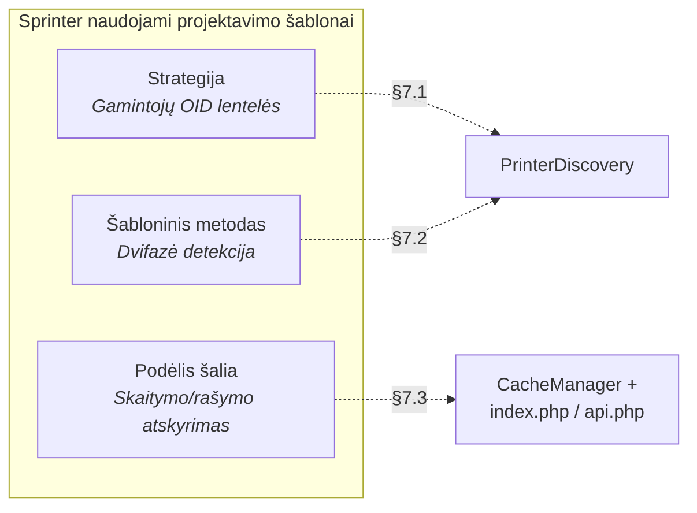

### 7.1 Strategijos šablonas: gamintojams būdingas SNMP apdorojimas

Metodas `getDirectSupplyLevels()` naudoja strategijos tipo principą, kuriame OID lentelė keičiasi priklausomai nuo aptikto gamintojo:

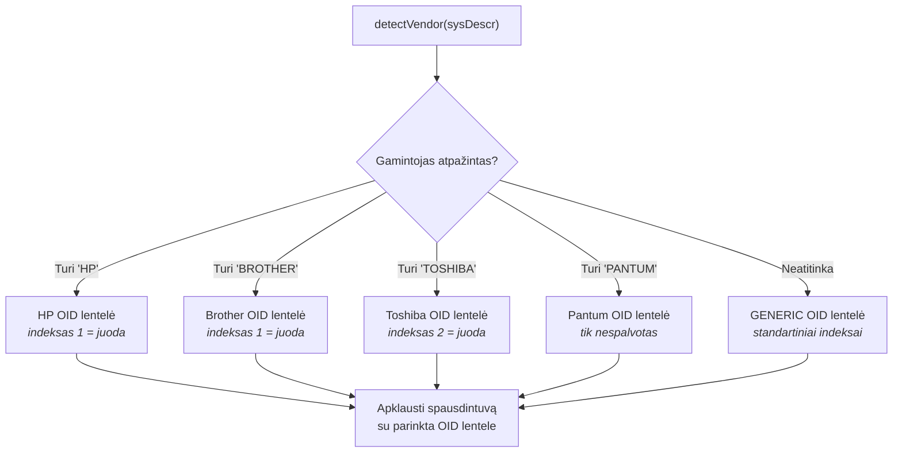

```php
$oidMappings = [
    'HP'      => ['max_black' => '...8.1.1', 'black' => '...9.1.1', ...],
    'TOSHIBA' => ['max_black' => '...8.1.2', 'black' => '...9.1.2', ...],
    'BROTHER' => ['max_black' => '...8.1.1', 'black' => '...9.1.1', ...],
    // ...
];

$oids = $oidMappings[$vendorName] ?? $oidMappings['GENERIC'];
```

### 7.2 Šabloninio metodo šablonas: dvifazė medžiagų detekcija

Eksploatacinių medžiagų lygių nuskaitymas atitinka šabloninio metodo šabloną su dviem fazėmis:

| Fazė | Aprašymas |
|------|-----------|
| 1    | Bandyti gamintojui būdingus tiesioginius OID (greita, gali nepavykti) |
| 2    | Pereiti prie standartinio MIB perėjimo (universalus, lėtesnis) |

```php
private function getSupplyLevels(string $ip): array {
    // 1 fazė: tiesioginiai gamintojo OID
    $directLevels = $this->getDirectSupplyLevels($ip);
    if (!empty($directLevels)) {
        return $directLevels;
    }

    // 2 fazė: standartinis MIB perėjimas (atsarginis)
    $supplyTable = snmp2_real_walk($ip, ..., '.1.3.6.1.2.1.43.11.1.1', ...);
    // Analizuoti aprašymus, apskaičiuoti procentus...
}
```

### 7.3 Podėliavimo strategija: trumpas kiekvieno spausdintuvo atnaujinimo podėlis

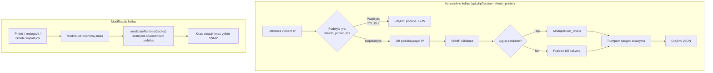

```php
// Atnaujinimo kelias: trumpas kiekvieno spausdintuvo podėlis (api.php)
$refreshCache = new CacheManager('cache', REFRESH_CACHE_TTL_SECONDS);
$cacheKey = 'refresh_printer_' . $ip;
$cachedRefresh = $refreshCache->get($cacheKey);
if (is_array($cachedRefresh)) {
    sendResponse($cachedRefresh);
}

$data = $discovery->getPrinterData($dbPrinter);
if (($data['info']['status'] ?? null) === 'online' && !empty($data['levels'])) {
    $db->updatePrinterLevelsIfChanged(
        (int)$dbPrinter['id'],
        $data['levels'],
        $dbPrinter['last_levels'] ?? null
    );
}
$refreshCache->set($cacheKey, $data);

// Modifikacijų kelias: invaliduoti visus runtime podėlio įrašus
function invalidateRuntimeCache(): void {
    (new CacheManager('cache'))->clear();
}
```

---

## 8. Duomenų bazės schema

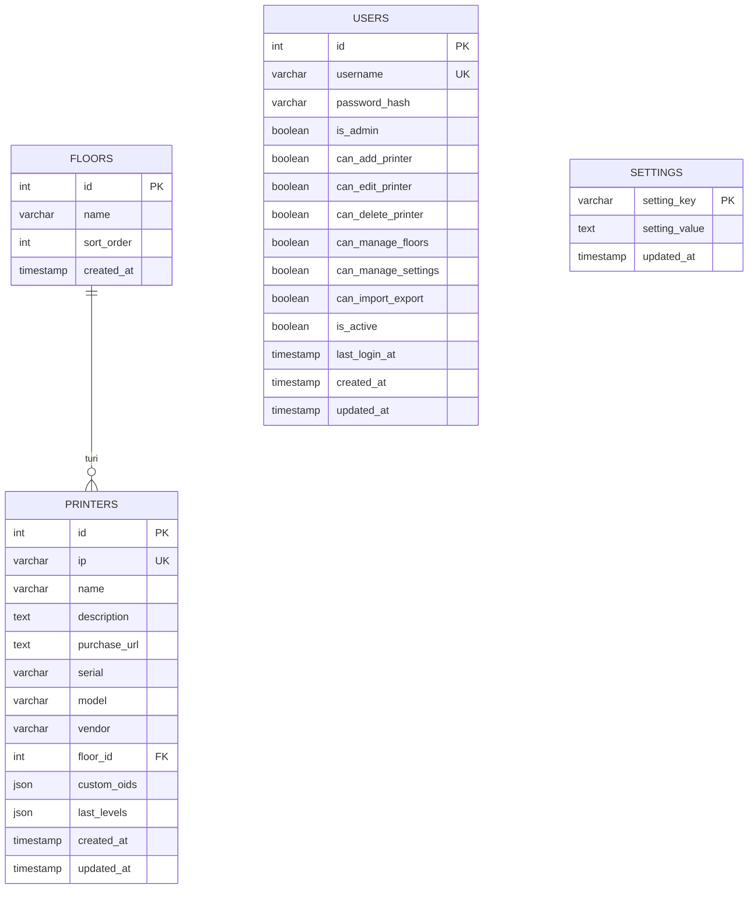

Schemos migracijos šablonas: programa tvarkingai apdoroja atnaujinimus tikrinant, ar stulpelis jau egzistuoja, prieš jį pridedant:

```php
// Patikrinti, ar stulpelis egzistuoja, prieš pridedant
$check = $this->pdo->query("SHOW COLUMNS FROM printers LIKE 'last_levels'");
if ($check->rowCount() === 0) {
    $this->pdo->exec("ALTER TABLE printers ADD COLUMN last_levels JSON ...");
}
```

---

## 9. CSS architektūra

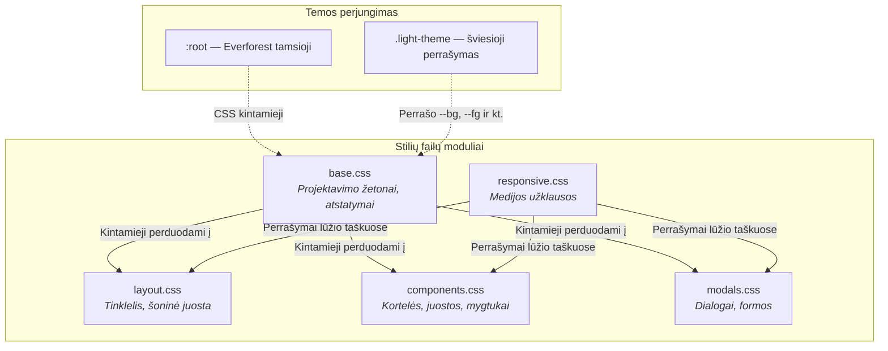

Stilių failai yra modularizuoti į penkis failus pagal atsakomybių atskyrimo principą:

| Failas | Atsakomybė | Pagrindinės savybės |
|--------|------------|---------------------|
| `base.css` | Projektavimo žetonai, temos kintamieji, atstatymai | CSS savybių kintamieji tamsiajai ir šviesiąjai temoms |
| `layout.css` | Puslapio struktūra, tinklelis, šoninė juosta | CSS Grid spausdintuvų kortelių išdėstymui |
| `components.css` | Spausdintuvų kortelės, mygtukai, lygio juostos | Animuotos dažų juostos, būsenos indikatoriai |
| `modals.css` | Dialogo langai, formos, nustatymai | Perdanga su fono suliejimu (backdrop blur) |
| `responsive.css` | Medijos užklausos, pritaikymas mobiliesiems | Lūžio taškai planšetiniam kompiuteriui ir mobiliajam telefonui |

Temų sistema naudojant CSS savybių kintamuosius:

```css
:root {
    /* Everforest tamsioji tema */
    --bg: #2d353b;
    --fg: #d3c6aa;
    --primary: #7fbbb3;
    --cube-bg: #475258;
    --cyan: #7fbbb3;
    --magenta: #d699b6;
    --yellow: #dbbc7f;
}

.light-theme {
    --bg: #f8f0dc;
    --fg: #5c6a72;
    --primary: #8da101;
    --cube-bg: #e9e5cf;
}
```

---

## 10. Įvardijimo konvencijos

Programos kodas nuosekliai laikosi šių konvencijų:

| Kontekstas | Konvencija | Pavyzdžiai |
|------------|-----------|------------|
| PHP klasės | PascalCase | `PrinterDiscovery`, `CacheManager` |
| PHP metodai | camelCase | `getPrinterData()`, `detectVendor()` |
| PHP kintamieji | camelCase | `dbPrinter`, `sysDescr`, `vendorName` |
| JS funkcijos | camelCase | `setupSearch()`, `checkIp()`, `deletePrinter()` |
| JS DOM identifikatoriai | camelCase | `printerSearch`, `settingsBtn`, `floorList` |
| CSS klasės | kebab-case | `level-fill`, `cube-footer`, `settings-nav-item` |
| DB stulpeliai | snake_case | `floor_id`, `purchase_url`, `last_levels` |
| API veiksmai | snake_case | `check_ip`, `add_printer`, `export_printers` |

Vengrų notacija niekur kode nenaudojama.

---

## 11. Ištaisytos klaidos ir jų priežasčių analizė

### 1 klaida: Brother nespalvotas lazerinis spausdintuvas rodo „Cyan" vietoj „Black" ✅

Paveikti modeliai: DCP-L, HL-L, MFC-L serijos (nespalvoti lazeriniai spausdintuvai)

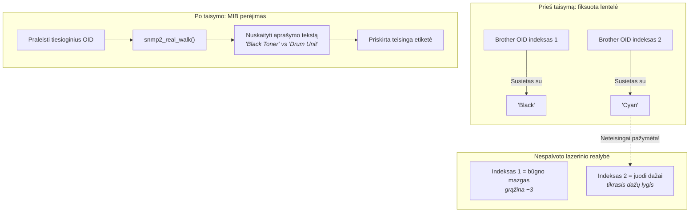

Priežastis: fiksuota BROTHER OID lentelė daro prielaidą, kad indeksas 1 = juoda, indeksas 2 = žydra. Nespalvotuose lazeriniuose spausdintuvuose indeksas 1 yra būgno mazgas (grąžina `-3`), o indeksas 2 yra juodi dažai. Kodas indeksą 2 pagal pavadinimą priskiria „cyan" (žydra) spalvai.

Taikytas taisymas: Brother nespalvoti lazeriniai spausdintuvai dabar praleidžia tiesioginius OID. Standartinis MIB perėjimas nuskaito eksploatacinių medžiagų aprašymus ir teisingai atskiria dažus nuo būgno.

### 2 klaida: Pantum spausdintuvai neatpažįstami ✅

Priežastis: `detectVendor()` metode nebuvo `'PANTUM'` įrašo. Gamintojas buvo priskiriamas `GENERIC` kategorijai.

Taikytas taisymas: pridėtas `'PANTUM' => ['pantum']` įrašas gamintojo aptikimo logikoje ir nespalvotam spausdintuvui pritaikyta OID lentelė.

### 3 klaida: serijinis numeris rodomas kaip „Hex-STRING: 00 00 00 00" ✅

Priežastis: `sanitizeSnmpValue()` metodas šalino `STRING:`, `INTEGER:`, `Counter32:`, `Gauge32:`, `Timeticks:` priešdėlius, bet ne `Hex-STRING:` priešdėlį.

Taikytas taisymas: `Hex-STRING:` reikšmės dabar dekoduojamos iš šešioliktainių baitų į ASCII simbolius. Visos nulinės reikšmės grąžina `N/A`.
