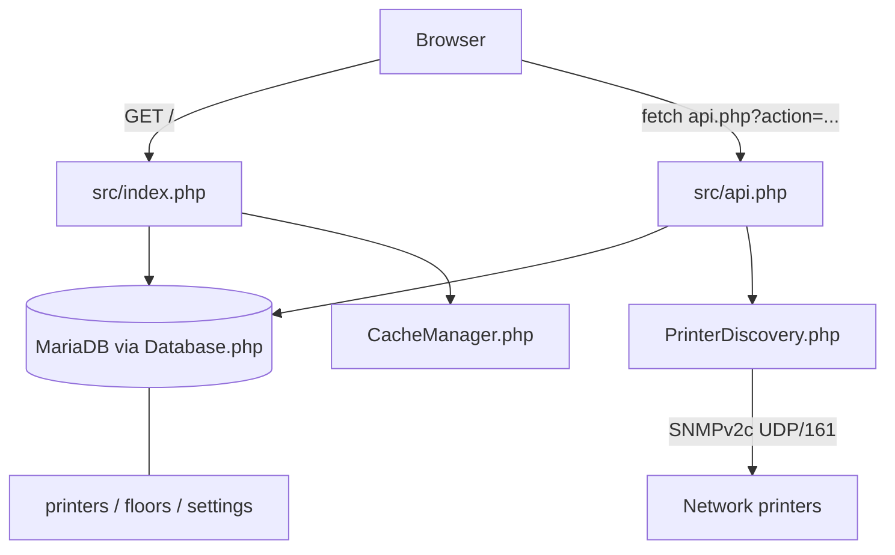

# S-printer Project Analysis

This analysis summarizes the current S-printer codebase and the DOX adaptation decisions. It is based on static inspection of the project files plus available local validation.

## Executive summary

S-printer is a compact, no-framework printer monitoring web app:

- **Backend/runtime:** PHP 8.2 on Apache.
- **Database:** MariaDB 10.6 through PDO.
- **Printer protocol:** SNMPv2c through PHP SNMP functions.
- **Frontend:** server-rendered PHP HTML plus vanilla JavaScript.
- **Styling:** five CSS modules loaded directly by `index.php`.
- **Deployment:** Docker Compose with `web` and `db` services.

The codebase is small enough for a three-file DOX tree:

- `AGENTS.md`
- `src/AGENTS.md`
- `src/css/AGENTS.md`

The highest-value maintenance contracts are API response shape, DB schema/idempotent migrations, SNMP level semantics, JS-owned level rendering, DOM/CSS class contracts, and Docker runtime assumptions.

## File inventory

| File | Lines | Role |
|---|---:|---|
| `README.md` | 2 | Minimal project title/description. |
| `Dockerfile` | 35 | Builds `php:8.2-apache`, installs SNMP/PDO MySQL, enables Apache modules, defines healthcheck. |
| `docker-compose.yml` | 34 | Local web/db stack, port `8080:80`, bind mounts `./src`, configures DB/SNMP env vars. |
| `apache-vhost.conf` | 20 | Apache document root, directory rules, security headers. |
| `jsconfig.json` | 99 | IDE/IntelliSense configuration for `src/**/*.js`; no runtime effect. |
| `architecture.md` | 993 | English technical architecture/thesis documentation. |
| `architektura.md` | 1001 | Lithuanian architecture/thesis documentation. |
| `src/index.php` | 436 | Dashboard entrypoint, initial card shell render, security headers, modals, bootstrap data. |
| `src/api.php` | 586 | JSON API action router with centralized validation. |
| `src/Database.php` | 514 | PDO DB connection, schema creation/migration, CRUD, settings, import/export helpers. |
| `src/PrinterDiscovery.php` | 645 | SNMP printer detection and consumable parsing. |
| `src/CacheManager.php` | 138 | Simple JSON file cache. |
| `src/Formatting.php` | 72 | Shared PHP display-format and JSON-escaping helpers. |
| `src/script.js` | 1245 | Browser initialization, DOM-safe level rendering, API calls, modals, refresh, search/filtering, import/export/settings. |
| `src/css/base.css` | 173 | Reset, design tokens, themes, focus styles. |
| `src/css/layout.css` | 310 | Header, main layout, sidebar, grid, refresh/empty/error states. |
| `src/css/components.css` | 509 | Printer cards, status indicators, level bars, buttons, FAB. |
| `src/css/modals.css` | 617 | Modal/form/settings/floor manager/toggle styles. |
| `src/css/responsive.css` | 665 | Animations, responsive behavior, late component overrides. |

## Architecture overview



### Runtime lifecycle in current code

1. Browser requests `/`.
2. `index.php` loads config, applies security headers, instantiates `Database`, `CacheManager`, and `PrinterDiscovery`.
3. `Database` connects and runs `initSchema()` idempotently.
4. `index.php` fetches printers, floors, and settings from DB.
5. Initial printer card shells render in `loading` state with last-known levels encoded in `data-initial-*` attributes.
6. `index.php` bootstraps settings/floors into `window.__SPRINTER_BOOTSTRAP__`.
7. `script.js` hydrates initial level sections with its DOM renderer and calls `refreshAllPrinters()`.
8. `refreshAllPrinters()` calls `api.php?action=refresh_printer&ip=...` for each card with concurrency limit `4`.
9. `api.php` looks up the printer by IP, queries SNMP through `PrinterDiscovery`, stores fresh levels when online, and returns JSON.
10. `script.js` updates each card's status, levels, name, serial, and edit data.

### Important documentation mismatch

`architecture.md` / `architektura.md` request-lifecycle and client-side XSS sections now reflect async per-printer refresh and JS-owned DOM rendering. Their older cache-aside design-pattern section still describes a broader historical/aspirational cache strategy and should be revisited during Phase 3 if cache behavior changes.

## Backend analysis

### `Database.php`

Responsibilities:

- Reads DB connection settings from environment (`DB_HOST`, `DB_NAME`, `DB_USER`, `DB_PASS`).
- Opens PDO MySQL connection with exceptions, associative fetch mode, and native prepares.
- Initializes tables:
  - `floors`
  - `settings`
  - `printers`
- Provides CRUD for printers and floors.
- Stores last-known printer levels as JSON.
- Provides import/export support and settings accessors.

Durable contracts:

- `printers.ip` is unique.
- `printers.floor_id` is nullable and should point to `floors.id`.
- `settings` is key/value and only selected settings are allowed through the API.
- Schema initialization is in app startup, not external migrations.

Risks:

- Existing installs missing `custom_oids` may not be migrated; `last_levels` and `floor_id` have migration checks, but `custom_oids` does not.
- `floor_id` migration adds the column but does not add the foreign key on existing schemas.
- Import batching commits every 50 printers; if a later batch fails, earlier batches are already committed despite comments implying one transaction.
- No explicit upper bounds on import size.

### `api.php`

API actions:

- `check_ip`
- `add_printer`
- `edit_printer`
- `delete_printer`
- `export_printers`
- `import_printers`
- `refresh_printer`
- `get_floors`
- `add_floor`
- `edit_floor`
- `delete_floor`
- `get_settings`
- `save_settings`

Strengths:

- Central response helpers maintain a consistent JSON envelope.
- POST requests enforce `Content-Type: application/json`.
- Mutating actions check request method.
- Detailed errors are usually logged server-side while clients receive generic messages.
- Import supports old and new backup formats.

Risks:

- `check_ip` accepts POST JSON and can probe syntactically valid IPs from the server network; there is no rate limiting or auth.
- `add_printer` can be called directly with a syntactically valid IP without a preceding successful SNMP detection.
- Phase 1 added centralized IP/payload/settings validation and HTTP/HTTPS `purchase_url` validation in `api.php`; future write paths should use those helpers.
- There is no authentication/authorization, so any reachable user can mutate configuration and export printer data.
- Phase 1 aligned `api.php` with `index.php` by passing `SNMP_COMMUNITY` to `PrinterDiscovery`.

### `PrinterDiscovery.php`

Responsibilities:

- Validates and probes a specific printer IP.
- Reads system info and printer metadata OIDs.
- Detects vendor from sysDescr.
- Reads consumable levels using direct vendor mappings first, then Printer-MIB fallback.
- Handles Brother proprietary consumable data.
- Sanitizes SNMP values, including hex strings.

Durable contracts:

- sysDescr probe OID: `.1.3.6.1.2.1.1.1.0`
- Printer-MIB supply table: `.1.3.6.1.2.1.43.11.1.1`
- Special level semantics:
  - `-3` => OK/above threshold, rendered as 100 with `status: ok`
  - `-2` => unknown, skipped
  - `<= 0` => `status: empty_or_not_genuine`
- Supported vendor keywords include HP, Canon, Epson, Brother, Lexmark, Xerox, Kyocera, Ricoh, Konica, Samsung, Toshiba, Pantum, and Generic fallback.

Risks:

- Direct vendor OID logic can return partial data and skip a fuller MIB walk.
- Epson light cyan/light magenta OIDs are read but the direct output loop only includes `black`, `cyan`, `magenta`, `yellow`.
- SNMP timeout/retry values are optimized for local networks and may not fit high-latency networks.
- Real-printer validation is required for model-specific mappings.

### `CacheManager.php`

Responsibilities:

- Stores JSON cache files under a configured directory.
- Uses `md5($key)` to create safe cache file names.
- Expires files by modification time and configured TTL.

Risks / notes:

- Current async refresh flow mostly bypasses the cache documented in `architecture.md`.
- Mutations invalidate `printers_data`; update this if cache keys or data flows change.
- In bind-mounted development mode, cache files are created under `src/cache` if used.

## Frontend analysis

### `index.php`

Responsibilities:

- Sends app-level security headers.
- Loads printers, floors, settings from DB.
- Renders initial dashboard, floor sidebar, printer card shells, add/edit printer modal, settings modal, bootstrap data, and CSS/JS includes.
- Uses `Formatting.php` for display-only serial normalization and safe JSON emission.

Strengths:

- Most server-rendered fields use `htmlspecialchars`.
- Initial page does not block on SNMP for every printer.
- Handles DB connection startup failure with a loading overlay and auto-refresh.

Risks:

- Inline `onclick` handlers require global JS functions and force a CSP that allows inline script.
- The bootstrap inline script and inline event handlers still affect CSP tightening.

### `script.js`

Responsibilities:

- Bootstraps settings and floors from `window.__SPRINTER_BOOTSTRAP__` with API fallback.
- Theme toggle with localStorage.
- Search and floor filtering.
- Add/edit/delete printer modal flows.
- Check IP flow.
- Import/export backup flow.
- Settings/floor management.
- Display settings application.
- DOM-safe level rendering and card refresh.
- Refresh-all concurrency control.

Important contracts:

- Uses API response envelope from `api.php`.
- Depends on DOM IDs/classes emitted by `index.php`.
- `openEditModal()` and `deletePrinter()` are global due inline handlers.
- Uses `throttlePromises(tasks, 4)` for refresh concurrency.

Risks:

- Runtime browser validation is still needed because static checks cannot prove rendered UI behavior.
- Refresh rendering rebuilds level nodes; Phase 3 can optimize unchanged DOM updates if profiling shows churn.
- Modals lack robust accessibility semantics and focus handling.

## CSS analysis

The CSS is already modularized:

- `base.css`: foundational design tokens and themes.
- `layout.css`: macro layout and structural page regions.
- `components.css`: printer cards and reusable controls.
- `modals.css`: modal/form/settings UI.
- `responsive.css`: animations, media queries, and late overrides.

Contracts:

- Load order matters.
- `responsive.css` is not purely responsive; it deliberately overrides component styles.
- CSS custom properties define the theme system.
- Dynamic state classes from PHP/JS drive visual behavior.

Risks:

- Duplicate selectors across CSS modules are intentional but fragile (`.fab`, `.theme-toggle`, `.action-btn`).
- Accessibility can be improved for focus, reduced motion, status text, and progressbar semantics.
- Visual regressions require browser checks; syntax checks alone are insufficient.

## Deployment analysis

### Dockerfile

Strengths:

- Uses official `php:8.2-apache` image.
- Installs `libsnmp-dev`, `snmp`, `curl`.
- Installs PHP extensions `snmp` and `pdo_mysql`.
- Enables Apache `rewrite` and `headers`.
- Adds a healthcheck against `/`.

Risks / notes:

- `COPY src/ /var/www/html/` is commented out, so production image alone may not contain app source unless a volume or later copy is used.
- Healthcheck may fail while DB is still starting because `/` depends on DB readiness.

### docker-compose.yml

Strengths:

- Clear two-service local stack.
- Web exposed on `localhost:8080`.
- Environment variables configure DB and SNMP community.
- DB data persisted in named volume `db_data`.

Risks:

- `depends_on` controls startup order but not DB readiness.
- Development DB passwords are hardcoded.
- `SNMP_COMMUNITY=public` is the default and should be treated as a local/dev value.

### apache-vhost.conf

Strengths:

- Disables directory indexes.
- Enables expected document root.
- Adds security headers.

Risks:

- CSP allows `'unsafe-inline'`, required by current inline handlers/styles but weaker than ideal.
- Header values should stay aligned with PHP app headers.

## Security assessment

High-priority issues to address before exposing beyond a trusted LAN:

1. **No authentication or authorization.** Any reachable user can add/edit/delete printers/floors/settings, export data, import data, and trigger SNMP probes.
2. **Server-side request/probe risk.** `check_ip` can be used to probe internal IPs from the server network.
3. **Input validation gaps beyond Phase 1.** Core IP/URL/import shape validation is centralized, but auth/rate limits and network allowlisting remain open.
4. **Residual frontend injection/CSP risk.** Dynamic level rendering now uses DOM APIs, but inline handlers/bootstrap still require a weak CSP.
5. **Weak CSP due inline code/styles.** Tightening CSP requires removing inline handlers and moving bootstrap data to a non-inline pattern.

Medium-priority issues:

- Rate-limit SNMP-related endpoints.
- Improve error handling and logging consistency.

## Accessibility assessment

Current gaps:

- Modals should use `role="dialog"`, `aria-modal="true"`, focus trap, Escape-to-close, and focus return.
- Close controls should be buttons, not spans.
- Icon buttons need explicit `aria-label`.
- Status indicator is color-only.
- Level bars should use `role="progressbar"` with ARIA value attributes.
- Animations should respect `prefers-reduced-motion`.

## Verification status

Available checks completed during this adaptation:

- Inspected the target project tree.
- Confirmed no `graphify-out/GRAPH_REPORT.md` was present in the target folder.
- Confirmed the target folder is not a Git repository by `git status` failure.
- Retrieved upstream `agent0ai/dox` `AGENTS.md` and README.
- Parsed file inventory, PHP methods, API actions, JS functions, fetch actions, and DB table definitions.
- Added static Phase 1 and Phase 2 contract verifiers under `tools/`.
- Phase 2 static verification confirms JS-owned level rendering, bootstrap data, serial formatting deduplication, and Phase 1 regression contracts.

Environment blockers:

- Local `git status` failed because the folder is not a Git repo.
- PHP CLI availability must be checked in the active environment before `php -l`; if absent, use Docker.
- Docker availability must be checked before container build/runtime verification.

Recommended validation commands:

```sh
node --check src/script.js
node tools/verify-phase1.mjs
node tools/verify-phase2.mjs
php -l src/index.php
php -l src/api.php
php -l src/Database.php
php -l src/PrinterDiscovery.php
php -l src/CacheManager.php
php -l src/Formatting.php
docker compose config
docker compose build
docker compose up -d
curl -fsSI http://localhost:8080/
curl -fsS http://localhost:8080/api.php?action=get_settings
curl -fsS http://localhost:8080/api.php?action=get_floors
```

## Recommended next improvements

1. Update `architecture.md` and `architektura.md` to reflect async per-printer refresh instead of synchronous cache-aside page-load SNMP.
2. Remove inline event handlers/bootstrap script so CSP can be tightened.
3. Add auth or network access controls before non-LAN deployment.
4. Add accessibility improvements for modals, icon buttons, status, and level bars.
5. Add runtime/API smoke tests once PHP/Docker are available.
6. Consider `.dockerignore` and production source-copy behavior in `Dockerfile`.
7. Add per-printer SNMP refresh caching and avoid unchanged DB level writes.
8. Reuse unchanged level DOM nodes where practical after profiling.
9. Keep DOX docs current whenever these contracts change.
